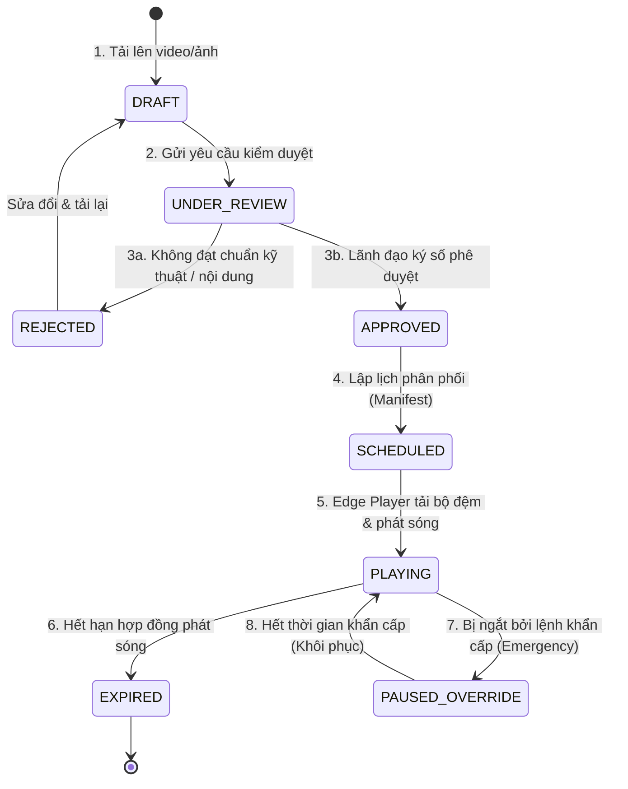

# ĐẶC TẢ NGHIỆP VỤ & QUY CHUẨN KỸ THUẬT AN TOÀN (GATE G1)
## HỆ THỐNG GIÁM SÁT & ĐIỀU KHIỂN CHIẾU SÁNG THÔNG MINH VÀ MÀN HÌNH LED NGOÀI TRỜI

> **Mã công việc Jira:** `SCRUM-13` ([W3-PO] Đặc tả yêu cầu luồng phê duyệt nội dung LED đa tầng & Quy chuẩn an toàn chiếu sáng đô thị)  
> **Người thực hiện:** **Trần Đình Trọng** (Product Owner & Project Lead)  
> **Đơn vị phối hợp:** Công ty TNHH Kỹ thuật Tin học Phúc Châu (PCCOM CO., LTD)  
> **Đơn vị đào tạo:** Khoa Công nghệ Thông tin - Trường Đại học Giao thông Vận tải (UTH)  
> **Áp dụng cho:** Sprint 2 (Tuần 3 & 4) - Hồ sơ thiết kế kỹ thuật Cổng Gate G1 Design Approval  

---

## I. MỤC ĐÍCH & PHẠM VI TÀI LIỆU

Tài liệu này xác lập khung pháp lý, quy tắc nghiệp vụ và các ngưỡng giới hạn kỹ thuật an toàn bắt buộc tuân thủ đối với:

1. **Phân hệ Màn hình LED Ngoài trời (Outdoor LED Display - Packages B & C):** Triển khai quy trình kiểm duyệt nội dung phát sóng đa tầng (DSP 02 - DSP 04) và cơ chế phát sóng khẩn cấp ưu tiên cao (DSP 08).
2. **Phân hệ Chiếu sáng Đô thị Thông minh (Smart Street Lighting - Packages A & C):** Thiết lập các ngưỡng an toàn quang học, giới hạn độ chói/độ rọi theo Tiêu chuẩn Quốc gia **TCVN 259:2001** (LGT 02) và thuật toán giảm dòng khởi động bảo vệ lưới điện đô thị (LGT 08).
3. **Căn cứ bàn giao kỹ thuật:** Cung cấp đầu vào trực tiếp cho **Backend Developer** (`SCRUM-19`: Thiết kế OpenAPI & RBAC) và **IoT Developer** (`SCRUM-17`: Lập trình thuật toán Dimming & DALI Driver).

---

## II. ĐẶC TẢ LUỒNG PHÊ DUYỆT NỘI DUNG LED ĐA TẦNG (DSP 02 - DSP 04)

### 1. Phân quyền vai trò người dùng (Role-Based Access Control - RBAC)
Để triệt tiêu hoàn toàn rủi ro hiển thị nội dung phản cảm, vi phạm bản quyền hoặc tấn công thay đổi nội dung trái phép, hệ thống áp dụng cơ chế phân quyền 4 cấp độc lập:

| Vai trò (Role) | Người chịu trách nhiệm | Quyền hạn trên hệ thống (Permissions) | Trách nhiệm pháp lý & nghiệp vụ |
| :--- | :--- | :--- | :--- |
| **`CONTENT_CREATOR`**<br/>(Người soạn thảo) | Đối tác quảng cáo / Cán bộ truyền thông | – Tải tệp đa phương tiện (Video/Ảnh) lên Content Library.<br/>– Đăng ký khung giờ phát dự kiến (Slot & Duration). | Chịu trách nhiệm về bản quyền tác phẩm và nguồn gốc nội dung. |
| **`CONTENT_EDITOR`**<br/>(Biên tập viên kỹ thuật) | Kỹ sư vận hành hệ thống PCCOM | – Kiểm tra định dạng kỹ thuật (Format, Bitrate, Resolution).<br/>– Kiểm duyệt sơ bộ nội dung thuần phong mỹ tục.<br/>– Trả về yêu cầu chỉnh sửa nếu không đạt. | Đảm bảo tệp tương thích 100% với phần cứng màn hình ngoài trời. |
| **`APPROVAL_AUTHORITY`**<br/>(Cấp phê duyệt có thẩm quyền) | **Product Owner (Trần Đình Trọng)** / Lãnh đạo PCCOM | – Xem trước (Preview) video phát sóng.<br/>– Ký số duyệt phát hành (Digital Sign Token).<br/>– Đình chỉ hoặc hủy bỏ lệnh phát sóng. | Phê duyệt cao nhất trước khi nội dung được phân phối xuống thiết bị ngoại vi. |
| **`EMERGENCY_OPERATOR`**<br/>(Cán bộ trực ban khẩn cấp) | Cơ quan chức năng đô thị / Trung tâm NOC | – Kích hoạt phát sóng khẩn cấp (Emergency Broadcast).<br/>– Ghi đè toàn bộ lịch phát thông thường trong 15s. | Chỉ sử dụng khi có lệnh từ Ban chỉ huy Phòng chống thiên tai hoặc Công an thành phố. |

---

### 2. Sơ đồ trạng thái vòng đời nội dung (State Machine Lifecycle)



### 3. Tiêu chuẩn kỹ thuật nội dung phát sóng (DSP 02)

– **Định dạng video được chấp nhận:** H.264 / MP4, H.265 / HEVC.  
– **Tỷ lệ khung hình:** 16:9 hoặc định dạng tùy chỉnh theo độ phân giải thực tế của màn hình (ví dụ: $1920 \times 1080$, $1280 \times 720$).  
– **Thời lượng phát mỗi lượt (Slot Duration):** 15 giây hoặc 30 giây.  
– **Tần suất quét an toàn (Refresh Rate):** Tối thiểu 1920 Hz để không bị chớp sọc khi quay phim/chụp ảnh.  
– **Độ sáng tự thích ứng ban ngày/ban đêm:**  
  – Ban ngày trời nắng (Ambient $> 20,000\text{ lux}$): Tự nâng độ sáng lên $5,000 - 6,500\text{ nits}$ để chống chói nắng.  
  – Ban đêm (Ambient $< 50\text{ lux}$): Tự hạ độ sáng xuống $500 - 800\text{ nits}$ nhằm chống lóa mắt tài xế lái xe, ngăn ngừa tai nạn giao thông.  

---

## III. CƠ CHẾ PHÁT SÓNG KHẨN CẤP (EMERGENCY BROADCAST OVERRIDE - DSP 08)

Khi xảy ra các tình huống cấp bách như: Bão lũ triều cường, hỏa hoạn, ùn tắc giao thông đặc biệt nghiêm trọng, hệ thống kích hoạt luồng phát sóng khẩn cấp tuân thủ các chỉ tiêu:

1. **Thời gian đáp ứng (Latency Threshold):**  
   – Lệnh khẩn cấp từ Web Console $\rightarrow$ Cloud Broker $\rightarrow$ Màn hình LED ngoại vi phải được thực thi và hiển thị trên màn hình trong vòng **dưới 15 giây** (Đạt chỉ tiêu DSP 08).  

2. **Cơ chế hoạt động:**  
   – Đóng băng (Suspend) danh sách phát quảng cáo thương mại đang chạy.  
   – Chuyển toàn bộ khung hiển thị sang thông điệp khẩn cấp (nền đỏ/vàng, chữ trắng lớn, icon cảnh báo quốc tế).  
   – Thiết lập thời gian hiệu lực tự động (Time-To-Live - TTL): Ví dụ 15 phút, 30 phút, 2 giờ tùy mức độ khẩn cấp.  

3. **Cơ chế tự động khôi phục (Clean Recovery):**  
   – Khi bộ đếm TTL về 0, Edge Controller tự động dọn dẹp bộ nhớ đệm và quay trở lại danh sách phát thương mại bình thường mà không cần bất kỳ thao tác thủ công nào từ con người.  

4. **Nhật ký kiểm toán bắt buộc (Audit Logging):**  
   – Mọi thao tác phát sóng khẩn cấp đều phải lưu vĩnh viễn vào cơ sở dữ liệu kiểm toán (Audit Table): `operator_id`, `timestamp`, `severity_level`, `emergency_reason`, `ttl_seconds`, `approval_authority`.  

---

## IV. QUY CHUẨN AN TOÀN QUANG HỌC CHIẾU SÁNG ĐÔ THỊ (LGT 02 & TCVN 259:2001)

Hệ thống điều khiển chiếu sáng thông minh phải đảm bảo an toàn giao thông đô thị và tối ưu hóa năng lượng theo các ngưỡng quy định:

### 1. Bảng phân loại tuyến đường & Ngưỡng độ rọi tối thiểu (Photometric Limits)

| Phân cấp đường phố | Vị trí Pilot áp dụng | Độ rọi trung bình tối thiểu ($E_{tb}$) | Độ chói mặt đường ($L_{tb}$) | Hệ số đồng đều chung ($U_0$) | Giới hạn Dimming tối đa cho phép |
| :--- | :--- | :---: | :---: | :---: | :---: |
| **Cấp A - Đại lộ, Trục chính** | Đường D1 (Khu Công nghệ cao Quận 9) | $\ge 30\text{ lux}$ | $\ge 1.5\text{ cd/m}^2$ | $\ge 0.4$ | Không được dimming dưới **40%** |
| **Cấp B - Đường phân kỳ, nội bộ** | Khuôn viên Trường ĐH Giao thông Vận tải (Cơ sở 2) | $\ge 15\text{ lux}$ | $\ge 0.8\text{ cd/m}^2$ | $\ge 0.35$ | Không được dimming dưới **30%** |

---

### 2. Kịch bản điều khiển độ sáng thích ứng theo thời gian (Adaptive Schedule)

```
[100% Công suất] --------------------+ 18:00 - 22:00 (Giờ cao điểm giao thông)
                                     |
[ 70% Công suất]                     +--------------------+ 22:00 - 00:00 (Giao thông giảm)
                                                          |
[ 40% Công suất]                                          +---------------------+ 00:00 - 05:00 (Đêm khuya an toàn)
                                                                                |
[ Tắt đèn ]                                                                     +-----> 05:30 (Trời sáng)
```

– **18:00 – 22:00 (Giờ cao điểm):** 100% độ sáng. Đảm bảo tầm nhìn tối đa cho xe cộ và người đi bộ.  
– **22:00 – 00:00 (Lưu lượng giảm):** Giảm sáng xuống **70%** (Tiết kiệm 30% điện năng mà mắt người hầu như không nhận ra sự khác biệt).  
– **00:00 – 05:00 (Đêm vắng):** Giảm sáng xuống **40%** (Mức sàn tối thiểu an toàn để phòng chống tệ nạn xã hội và hỗ trợ camera an ninh đô thị quan sát rõ).  
– **05:00 – 05:30 (Rạng sáng):** Cảm biến quang BH1750 đo ánh sáng mặt trời đạt $> 50\text{ lux}$ thì tự động ngắt đèn hoàn toàn.  

---

### 3. Quy chuẩn bảo vệ phần cứng và an toàn điện (LGT 05 & LGT 08)

1. **Thuật toán giảm dòng khởi động bằng chuyển mạch so le (Staggered Inrush Mitigation - LGT 08):**  
   – Để ngăn hiện tượng nhảy áp trạm biến áp khi 50 điểm đèn cùng bật lúc 18h00, hệ thống chia mạng lưới thành 3 nhóm pha ($R - S - T$).  
   – Thời gian bật đèn của các nhóm được trễ nhau $500\text{ ms}$ và áp dụng đường cong tăng sáng mềm (Soft Ramp-up) từ 0% lên 100% trong vòng 3 giây.  

2. **Cơ chế tự bảo vệ quá nhiệt (Thermal Derating Engine - LGT 05):**  
   – Nhiệt độ chip LED bình thường: $< 65^\circ\text{C}$.  
   – Cảnh báo Cấp 1 ($65^\circ\text{C} - 75^\circ\text{C}$): Giữ nguyên công suất, ghi nhật ký cảnh báo sớm.  
   – Cảnh báo Cấp 2 ($75^\circ\text{C} - 85^\circ\text{C}$): Tự động giảm tức thì **20% độ sáng** để hạ nhiệt bóng đèn.  
   – Ngắt bảo vệ khẩn cấp ($> 90^\circ\text{C}$): Tự động ngắt nguồn rơ-le để chống chập nổ bo mạch và gửi mã lỗi `F01: OVERHEAT_CRITICAL` lên trung tâm.  

---

## V. GIAO DIỆN CHUYỂN GIAO KỸ THUẬT CHO CÁC THÀNH VIÊN TRONG SPRINT 2

1. **Bàn giao cho Backend Developer (Trần Hoài Nguyên Vỹ - `SCRUM-19`):**  
   – Triển khai các REST API:  
     – `POST /api/v1/content/submissions` (Dành cho Creator tải file).  
     – `PUT /api/v1/content/{id}/approval` (Dành cho PO duyệt ký số).  
     – `POST /api/v1/emergency/broadcast` (Kích hoạt bản tin khẩn cấp TTL).  
   – Thiết lập Middleware kiểm tra quyền RBAC với JWT Token.  

2. **Bàn giao cho IoT & Edge Developer (Nguyễn Tấn Vượng - `SCRUM-17`):**  
   – Áp dụng các ngưỡng Dimming 100% - 70% - 40% vào firmware ESP32.  
   – Cấu hình hàm bảo vệ quá nhiệt ngắt tải khi $T > 85^\circ\text{C}$.  

3. **Bàn giao cho QA Developer (Nguyễn Đại Phước - `SCRUM-22`):**  
   – Xây dựng ca kiểm thử tự động xác thực thời gian đáp ứng lệnh khẩn cấp $< 15\text{s}$.  
   – Kiểm tra ngưỡng an toàn độ rọi không được rơi xuống dưới 30% khi điều khiển thủ công.  

---

## VI. KẾT LUẬN & CHỮA DUYỆT CỦA PRODUCT OWNER

Tài liệu này là căn cứ pháp lý và kỹ thuật chính thức thuộc hồ sơ nghiệm thu **Gate G1 Design Approval**. Mọi thay đổi về thông số kỹ thuật đều phải được thông qua Product Owner và đại diện kỹ thuật của PCCOM CO., LTD.

*TP. Hồ Chí Minh, ngày 14 tháng 11 năm 2026*  
**ĐẠI DIỆN PRODUCT OWNER & TRƯỞNG NHÓM ĐỒ ÁN**  
*(Đã ký)*  
**Trần Đình Trọng**
