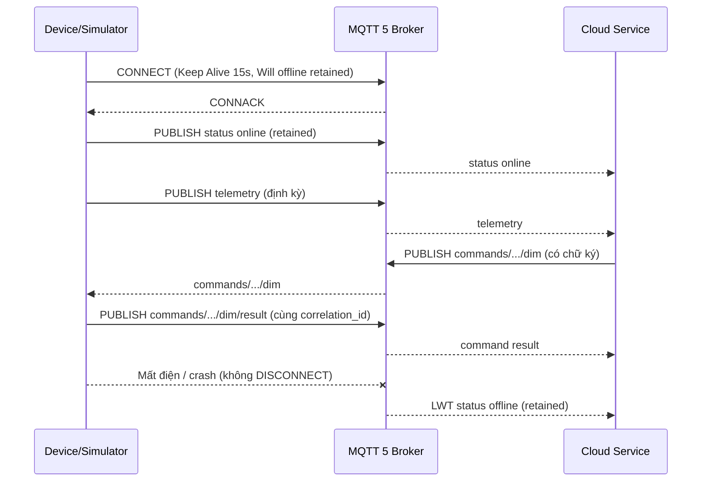

# ĐẶC TẢ GIAO THỨC MQTT 5 CHO THIẾT BỊ BIÊN VÀ CLOUD

> **Mã tài liệu:** `MQTT5-COMM-v1.0.0`  
> **Áp dụng cho:** Virtual Edge Simulator, Mock Cloud Service, Core API và firmware gateway/controller PCCOM  
> **Phiên bản giao thức:** `v1`  
> **Ngày ban hành:** 14/11/2026  
> **Trạng thái:** Đã triển khai trong mã nguồn, có kiểm thử E2E và LWT thực tế

---

## I. MỤC ĐÍCH VÀ PHẠM VI

Tài liệu này đặc tả giao thức MQTT 5 hai chiều giữa thiết bị biên (Controller/Gateway/đèn/LED)
và Cloud Broker. Mục tiêu:

1. Thống nhất taxonomy topic, QoS, retain và MQTT 5 Properties cho toàn bộ hệ thống.
2. Bảo đảm mọi bản tin đều có định danh (`correlation_id`), thời gian (`ts_ms`) và
   chữ ký HMAC-SHA256 để chống giả mạo và replay.
3. Chuẩn hóa cơ chế phát hiện online/offline bằng Last Will and Testament (LWT) trong
   ngân sách 30 giây.
4. Làm cơ sở cho ACL broker, kiểm thử tích hợp và chuyển giao cho PCCOM.

Phạm vi payload nghiệp vụ (telemetry, command, result, status, alert) giữ tương thích với
schema hiện có trong `docs/data_contracts/schemas.json`; tài liệu này bổ sung lớp giao vận
MQTT 5 và các trường định danh/bảo mật.

---

## II. THUẬT NGỮ

| Thuật ngữ | Ý nghĩa |
| :--- | :--- |
| **Thiết bị biên** | Đèn đường, màn hình LED hoặc gateway/controller kết nối broker |
| **Cloud** | Mock Cloud Service, Core API hoặc dịch vụ Cloud thật |
| **Topic** | Chuỗi định tuyến MQTT theo taxonomy `v1` |
| **Envelope** | Payload + bộ User Properties bắt buộc + MQTT 5 Properties |
| **LWT** | Last Will and Testament, bản tin broker tự phát khi client mất kết nối bất thường |
| **Replay window** | Cửa sổ thời gian và bộ nhớ correlation_id dùng để chống phát lại |
| **Correlation ID** | UUID4 dùng chung giữa lệnh và phản hồi, đồng thời là khóa chống replay |

---

## III. KIẾN TRÚC VÀ LUỒNG BẢN TIN



### 1. Tham số kết nối bắt buộc

| Tham số | Giá trị | Lý do |
| :--- | :--- | :--- |
| MQTT protocol | MQTT 5.0 | Cần User Properties, Correlation Data, Response Topic, Message Expiry, Will Delay |
| Keep Alive | **15 giây** | Broker phát hiện mất kết nối khoảng 1,5 × Keep Alive = 22,5 giây, nằm trong ngân sách 30 giây |
| Clean Start | `true` | Mỗi lần kết nối là một session mới, tránh hàng đợi lệnh cũ |
| Session Expiry Interval | `0` | Không giữ session sau khi ngắt; trạng thái retained và LWT đủ để Cloud theo dõi |
| Client ID | `{prefix}-{site}-{type}-{device_id}` | Mỗi thiết bị một kết nối riêng để LWT/status độc lập |
| Username/Password | Theo môi trường | Dev/test có thể để trống; production bắt buộc xác thực |
| TLS | Bật ở production | Dev/test dùng `broker.emqx.io:1883`; production dùng `8883` + TLS 1.2+ |

> **Lưu ý firmware ESP32:** thư viện PubSubClient hiện dùng MQTT 3.1.1, không hỗ trợ MQTT 5
> User Properties. Gateway ESP32 phải chạy MQTT 3.1.1 hoặc nâng cấp thư viện/thêm bridge
> MQTT 5. Đặc tả này là hợp đồng giữa Simulator/Cloud và gateway MQTT 5.

---

## IV. QUY ƯỚC QoS VÀ RETAIN

| Nhóm bản tin | Topic | Publisher | Subscriber | QoS | Retain | Ghi chú |
| :--- | :--- | :--- | :--- | :---: | :---: | :--- |
| Telemetry | `telemetry/v1/{site}/{type}/{id}` | Thiết bị | Cloud | 1 | **false** | Dữ liệu đo định kỳ, không cần giữ |
| Command dim | `commands/v1/{site}/{type}/{id}/dim` | Cloud | Thiết bị | 1 | **false** | Có Message Expiry 60s |
| Command result | `commands/v1/{site}/{type}/{id}/dim/result` | Thiết bị | Cloud | 1 | **false** | Dùng lại `correlation_id` của lệnh |
| Status | `status/v1/{site}/{type}/{id}` | Thiết bị / LWT | Cloud | 1 | **true** | `online`/`offline`, retained để Cloud mới subscribe thấy trạng thái gần nhất |
| Alert | `alerts/v1/{site}/{type}/{id}` | Thiết bị / Cloud | Cloud / Probe | 1 | **false** | Cảnh báo bảo mật/vận hành |

Quy tắc bổ sung:

- Chỉ **status** được retain. Telemetry, command, result và alert luôn `retain=false`.
- Tất cả bản tin dùng `Content Type`:
  - JSON: `application/json`
  - Status/LWT: `text/plain; charset=utf-8`
- Payload JSON phải là UTF-8, không có BOM, serialize compact (`separators=(",", ":")`).
- Mọi PUBLISH đều có `Correlation Data` bằng bytes UTF-8 của `correlation_id`.
- Lệnh dim có thêm `Response Topic` trỏ tới topic result tương ứng.
- Lệnh dim có `Message Expiry Interval = 60` giây.

---

## V. TAXONOMY TOPIC

### 1. Cấu trúc

```text
telemetry/v1/{site_id}/{device_type}/{device_id}
commands/v1/{site_id}/{device_type}/{device_id}/dim
commands/v1/{site_id}/{device_type}/{device_id}/dim/result
status/v1/{site_id}/{device_type}/{device_id}
alerts/v1/{site_id}/{device_type}/{device_id}
```

### 2. Ràng buộc segment

| Segment | Ràng buộc |
| :--- | :--- |
| `site_id` | `[A-Za-z0-9_-]{1,64}` |
| `device_type` | Từ vựng đóng: `light`, `led_display`, `gateway` |
| `device_id` | `[A-Za-z0-9_-]{1,64}` |
| `v1` | Phiên bản taxonomy, hiện cố định `v1` |

Cấm tuyệt đối ký tự `/`, `+`, `#`, khoảng trắng, newline và ký tự điều khiển trong segment.
Mọi module phải dùng helper trong `src/iot_protocol/topics.py` thay vì tự ghép chuỗi.

### 3. Wildcard Cloud sử dụng

| Mục đích | Wildcard |
| :--- | :--- |
| Telemetry toàn hệ thống | `telemetry/v1/+/+/+` |
| Status toàn hệ thống | `status/v1/+/+/+` |
| Alert toàn hệ thống | `alerts/v1/+/+/+` |
| Result toàn hệ thống | `commands/v1/+/+/+/dim/result` |
| Audit lệnh dim | `commands/v1/+/+/+/dim` |

Dùng `+` thay vì `#` để tránh subscribe nhầm các nhánh con ngoài phạm vi.

### 4. Ví dụ

```text
telemetry/v1/SITE_01/light/LGT_NODE_001
commands/v1/SITE_01/light/LGT_NODE_001/dim
commands/v1/SITE_01/light/LGT_NODE_001/dim/result
status/v1/SITE_01/led_display/DSP_LED_001
alerts/v1/SITE_02/led_display/DSP_LED_002
```

---

## VI. USER PROPERTIES VÀ CHỮ KÝ

### 1. Bộ User Properties bắt buộc

Mọi PUBLISH và Will message phải có đủ ba khóa sau, mỗi khóa xuất hiện **đúng một lần**:

| Khóa | Kiểu | Mô tả |
| :--- | :--- | :--- |
| `correlation_id` | UUID4 string | Định danh message; lệnh và result dùng chung giá trị |
| `ts_ms` | Chuỗi số nguyên | Thời điểm tạo message, epoch mili-giây |
| `signature` | Hex lowercase 64 ký tự | HMAC-SHA256 trên chuỗi canonical |

Thiếu, trùng hoặc sai định dạng bất kỳ khóa nào đều bị từ chối với alert
`SEC_HEADER_MISSING`.

### 2. Chuỗi canonical

```text
v1\n
{topic}\n
{correlation_id}\n
{ts_ms}\n
{payload}
```

Trong đó `{payload}` là bytes UTF-8 chính xác đã publish và là trường cuối cùng, nên payload
được phép chứa newline. Dấu `\n` giữa các trường tránh nhập nhằng khi ghép chuỗi.

Mã tham chiếu: `src/iot_protocol/signing.py` (hàm `canonical_string`, `sign_message`).

### 3. Dẫn xuất khóa theo thiết bị

Không lưu khóa riêng cho từng thiết bị. Khóa HMAC được dẫn xuất từ master secret:

```text
device_key = HMAC-SHA256(master_secret, "{site_id}/{device_type}/{device_id}")
```

- `master_secret`: đọc từ `security.signing_secret` hoặc biến môi trường `SIM_SIGNING_SECRET`.
- `device_key`: 32 byte nhị phân, dùng trực tiếp cho HMAC-SHA256.
- Một thiết bị bị lộ khóa không thể giả mạo thiết bị khác.
- Không commit khóa thật; chỉ dùng giá trị dev/test trong `config.example.json`.

### 4. Thứ tự xác thực phía nhận

1. Kiểm tra topic khớp taxonomy và đúng thiết bị.
2. Chuẩn hóa User Properties, kiểm tra đủ/không trùng.
3. Kiểm tra `Correlation Data` (nếu có) khớp `correlation_id`.
4. Xác thực chữ ký HMAC **trước** khi ghi nhận replay.
5. Kiểm tra replay (trừ status/LWT).
6. Parse payload và kiểm tra nghiệp vụ (hạn lệnh, action, giá trị).

### 5. Chống replay

| Tham số | Giá trị mặc định |
| :--- | :--- |
| Cửa sổ quá khứ | 30.000 ms |
| Dung sai tương lai | 30.000 ms |
| Bộ nhớ | Cache `correlation_id` trong cửa sổ, tự dọn mục cũ |

- `ts_ms < now - 30.000` hoặc `ts_ms > now + 30.000` bị từ chối.
- `correlation_id` đã xuất hiện trong cửa sổ bị từ chối.
- **Status/LWT được miễn kiểm tra timestamp và replay** vì Will message được ký tại thời
  điểm CONNECT, có thể đã cũ vài giây đến vài phút. Chữ ký vẫn bắt buộc.
- Telemetry, command, result và alert đều áp dụng đầy đủ replay guard.

---

## VII. DANH MỤC BẢN TIN VÀ PAYLOAD

### 1. Telemetry

Topic: `telemetry/v1/{site}/{type}/{id}`  
Hướng: Thiết bị → Cloud  
QoS 1, retain false, Content Type `application/json`

```json
{
  "schema_version": "1.0.0",
  "message_id": "MSG_1794660440618_LGT_NODE_001_2",
  "asset_id": "LGT_NODE_001",
  "sequence": 2,
  "source_time": 1794660440,
  "metrics": {
    "power_w": 48.67,
    "energy_wh": 0.21,
    "voltage_v": 219.5,
    "current_a": 0.22,
    "power_factor": 0.95,
    "temperature_c": 47.1,
    "ambient_lux": 262.3
  },
  "brightness_pct": 50,
  "relay_state": true,
  "quality": "GOOD"
}
```

### 2. Command dim

Topic: `commands/v1/{site}/{type}/{id}/dim`  
Hướng: Cloud → Thiết bị  
QoS 1, retain false, Content Type `application/json`

MQTT 5 Properties bắt buộc:

- `Message Expiry Interval = 60`
- `Correlation Data = correlation_id`
- `Response Topic = commands/v1/{site}/{type}/{id}/dim/result`
- User Properties: `correlation_id`, `ts_ms`, `signature`

```json
{
  "command_id": "ca1e1d49-fda1-4894-b98e-cb09353d5f79",
  "actor": "MockCloud_Operator",
  "action": "DIM",
  "requested_value": 65,
  "policy_version": "v1.0",
  "issued_at": 1794660441,
  "expires_at": 1794660501,
  "priority": 1
}
```

Quy tắc:

- `requested_value` phải là số nguyên trong `[0, 100]`.
- `expires_at` là epoch giây; thiết bị từ chối nếu thời điểm hiện tại lớn hơn.
- `command_id` mặc định trùng `correlation_id` nếu Cloud không gửi riêng.
- Thiết bị hỗ trợ `DIM` và `SWITCH`; action khác bị từ chối.

### 3. Command result

Topic: `commands/v1/{site}/{type}/{id}/dim/result`  
Hướng: Thiết bị → Cloud  
QoS 1, retain false, Content Type `application/json`  
`correlation_id` **phải trùng** lệnh gốc.

```json
{
  "command_id": "ca1e1d49-fda1-4894-b98e-cb09353d5f79",
  "asset_id": "LGT_NODE_001",
  "device_time": 1794660441,
  "status": "EXECUTED",
  "reason": "Virtual driver updated state",
  "observed_value": 65,
  "evidence_source": "VIRTUAL_PWM_SENSOR"
}
```

Các trạng thái:

| `status` | Ý nghĩa |
| :--- | :--- |
| `EXECUTED` | Lệnh đã thực thi |
| `REJECTED` | Lệnh sai action/giá trị |
| `EXPIRED` | Lệnh đến sau `expires_at` |

### 4. Status và LWT

Topic: `status/v1/{site}/{type}/{id}`  
Hướng: Thiết bị/LWT → Cloud  
QoS 1, **retain true**, Content Type `text/plain; charset=utf-8`

Payload:

```text
online
offline
```

- Khi CONNACK thành công, thiết bị publish `online` retained.
- Khi dừng chủ động, thiết bị publish `offline` retained rồi gửi DISCONNECT.
- Khi mất điện/mất mạng/crash, broker tự phát Will `offline` retained với cùng topic.

LWT được đăng ký tại CONNECT:

| Thuộc tính | Giá trị |
| :--- | :--- |
| Will QoS | 1 |
| Will Retain | `true` |
| Will Delay Interval | 0 giây |
| Will payload | `offline` |
| User Properties | `correlation_id`, `ts_ms`, `signature` được ký tại CONNECT |

> **Quan trọng:** `ts_ms` của LWT là thời điểm **đăng ký Will**, không phải thời điểm broker
> phát hiện mất kết nối. Cloud phải dùng thời điểm nhận bản tin (receive time) để đo độ trễ
> offline, không dùng `ts_ms` của LWT. Status/LWT được miễn replay guard.

### 5. Alert

Topic: `alerts/v1/{site}/{type}/{id}`  
Hướng: Thiết bị hoặc Cloud → Cloud/Probe  
QoS 1, retain false, Content Type `application/json`

```json
{
  "schema_version": "1.0.0",
  "alert_code": "SEC_SIGNATURE_INVALID",
  "severity": "HIGH",
  "message": "Chữ ký HMAC-SHA256 không hợp lệ",
  "device_id": "LGT_NODE_001",
  "ts_ms": 1794660441000,
  "related_correlation_id": "ca1e1d49-fda1-4894-b98e-cb09353d5f79"
}
```

`related_correlation_id` là tùy chọn, dùng để truy vết lệnh gây lỗi. Alert có
`correlation_id` riêng trong User Property.

---

## VIII. BẢNG MÃ ALERT VÀ HÀNH VI XỬ LÝ

| Mã alert | Severity | Nguyên nhân | Hành vi |
| :--- | :--- | :--- | :--- |
| `SEC_HEADER_MISSING` | HIGH | Thiếu/trùng/sai định dạng User Property hoặc Correlation Data không khớp | Từ chối message, phát alert |
| `SEC_SIGNATURE_INVALID` | HIGH | Chữ ký HMAC không hợp lệ | Từ chối message, phát alert |
| `SEC_REPLAY_DETECTED` | HIGH | Timestamp ngoài cửa sổ hoặc `correlation_id` đã dùng | Từ chối message, phát alert |
| `CMD_EXPIRED` | MEDIUM | Lệnh đến sau `expires_at` | Publish result `EXPIRED`, phát alert |
| `PROTOCOL_INVALID_PAYLOAD` | MEDIUM | Payload không phải JSON object hoặc sai kiểu | Từ chối, phát alert |
| `CMD_UNSUPPORTED_ACTION` | MEDIUM | Action không hỗ trợ hoặc giá trị dim ngoài `[0,100]` | Publish result `REJECTED`, phát alert |

Thứ tự kiểm tra phía thiết bị:

```text
topic -> header -> Correlation Data -> chữ ký -> replay -> JSON payload -> hạn lệnh -> action
```

---

## IX. LWT VÀ NGÂN SÁCH PHÁT HIỆN OFFLINE

| Kịch bản | Cơ chế | Thời gian phát hiện kỳ vọng |
| :--- | :--- | :--- |
| Dừng chủ động (`SIGINT`, hết `--run-seconds`) | Thiết bị publish `offline` retained + DISCONNECT | Tức thời |
| Crash/mất điện (không DISCONNECT) | Broker đóng TCP và phát Will | Thường < 1 giây nếu OS đóng socket; tối đa 1,5 × Keep Alive = 22,5 giây nếu mạng im lặng |
| Mất mạng hoàn toàn | Broker chờ Keep Alive rồi phát Will | ≤ 22,5 giây (đạt yêu cầu ≤ 30 giây) |

Khuyến nghị Cloud:

1. Subscribe `status/v1/+/+/+` với QoS 1 ngay khi khởi động.
2. Lưu trạng thái theo khóa `(site_id, device_type, device_id)`.
3. Khi nhận `offline`, ghi nhận `received_at` và phát cảnh báo vận hành.
4. Không dùng `ts_ms` của LWT làm thời điểm offline.
5. Có thể định kỳ publish empty retained payload để dọn trạng thái mồ côi khi thiết bị bị
   xóa khỏi cấu hình (xem `tools/mqtt5_probe.py clear-status`).

---

## X. CẤU HÌNH BROKER VÀ ACL

### 1. Môi trường dev/test

Repo cung cấp:

- `docker-compose.yml`: Mosquitto 2.x, cổng `1883`, cấu hình `deploy/mosquitto/mosquitto.conf`.
- `deploy/mosquitto/mosquitto.secure.conf.example`: mẫu TLS 8883 + xác thực.
- `deploy/mosquitto/aclfile.example`: mẫu ACL theo site/type/device.

Chạy local:

```bash
docker compose up -d
```

Nếu dùng broker công cộng, có thể đặt `broker.emqx.io:1883` trong `config.json` cho test
nhanh. **Không dùng broker công cộng cho production.**

### 2. Khuyến nghị production

| Hạng mục | Yêu cầu |
| :--- | :--- |
| Cổng | `8883` + TLS 1.2/1.3 |
| Xác thực | Username/password hoặc client certificate theo từng thiết bị |
| ACL | Thiết bị chỉ publish telemetry/status/result/alert của chính nó; chỉ subscribe command của chính nó |
| Cloud | Subscribe wildcard read-only theo site được phân quyền; publish command đúng site |
| Retain | Chỉ cho phép retain trên topic `status/v1/...` |
| Giám sát | Log connection/disconnection, will, ACL deny |

Mẫu ACL rút gọn:

```text
# Thiết bị SITE_01/light/LGT_NODE_001
user light_SITE_01_LGT_NODE_001
topic write telemetry/v1/SITE_01/light/LGT_NODE_001
topic write status/v1/SITE_01/light/LGT_NODE_001
topic write commands/v1/SITE_01/light/LGT_NODE_001/dim/result
topic write alerts/v1/SITE_01/light/LGT_NODE_001
topic read  commands/v1/SITE_01/light/LGT_NODE_001/dim

# Cloud vận hành
user cloud_operator
topic read  telemetry/v1/+/+/+
topic read  status/v1/+/+/+
topic read  alerts/v1/+/+/+
topic read  commands/v1/+/+/+/dim/result
topic write commands/v1/+/+/+/dim
```

ACL thực tế phải giới hạn theo site được phân quyền, không dùng wildcard toàn hệ thống cho
mọi tài khoản.

---

## XI. TƯƠNG THÍCH VÀ TRIỂN KHAI

| Thành phần | Trạng thái |
| :--- | :--- |
| `src/iot_protocol/` (topics, signing, headers, mqtt5) | Đã triển khai, có unit test |
| `src/edge_simulator/` | Đã triển khai MQTT 5, đa thiết bị, LWT, crash mode |
| `src/backend/mock_cloud_service.py` | Đã triển khai xác thực envelope và gửi lệnh có ký |
| `src/backend/core_api.py` | Đã publish lệnh MQTT 5 có ký theo từng thiết bị |
| `tools/mqtt5_probe.py` | Watch/send-dim/clear-status |
| Firmware ESP32 hiện tại | MQTT 3.1.1 (PubSubClient) — cần gateway/bridge hoặc nâng cấp thư viện để dùng MQTT 5 |

Khi chuyển firmware sang MQTT 5, cần bổ sung:

1. User Properties `correlation_id`, `ts_ms`, `signature`.
2. `Correlation Data`, `Response Topic`, `Message Expiry Interval` cho lệnh.
3. Will Properties với `Will Delay Interval = 0`.
4. Lưu master secret an toàn (NVS + mã hóa) hoặc khóa dẫn xuất riêng.

---

## XII. KIỂM THỬ VÀ BẰNG CHỨNG

| Hạng mục | Kết quả |
| :--- | :--- |
| Unit test protocol/config | 25 test pass |
| E2E telemetry + command + result | Pass, `correlation_id` khớp |
| LWT crash test | Pass, offline nhận sau khoảng 0,38 giây |
| Flake8/compile | Pass |

Chi tiết log và số đo xem `docs/test_reports/MQTT5_E2E_REPORT.md`.

---

## XIII. QUYẾT ĐỊNH THIẾT KẾ ĐÃ CHỐT

1. **HMAC-SHA256 thay vì chữ ký bất đối xứng:** phù hợp thiết bị biên tài nguyên thấp;
   khóa dẫn xuất theo thiết bị giới hạn phạm vi rò rỉ.
2. **Chỉ status được retain:** tránh Cloud xử lý lại telemetry/lệnh cũ sau khi khởi động.
3. **Session Expiry = 0:** tránh hàng đợi lệnh cũ cho thiết bị đã chết; ưu tiên trạng thái
   hiện tại hơn giao hàng lịch sử.
4. **Status/LWT miễn replay:** Will được ký tại CONNECT nên timestamp có thể cũ; chữ ký vẫn
   bảo vệ tính toàn vẹn.
5. **Message Expiry 60s chỉ cho lệnh dim:** lệnh điều khiển không có ý nghĩa sau 60 giây.
6. **Taxonomy có version `v1`:** cho phép thay đổi cấu trúc trong tương lai mà không phá
   client cũ.

---

## XIV. TÀI LIỆU THAM CHIẾU

- `src/iot_protocol/topics.py` — taxonomy và kiểm tra segment.
- `src/iot_protocol/signing.py` — canonical string, HMAC, dẫn xuất khóa, ReplayGuard.
- `src/iot_protocol/headers.py` — User Properties, xác thực envelope, mã alert.
- `src/iot_protocol/mqtt5.py` — MQTT 5 Properties cho PUBLISH/WILL/CONNECT.
- `src/edge_simulator/README.md` — hướng dẫn chạy simulator.
- `docs/data_contracts/schemas.json` — schema payload nghiệp vụ.
- `docs/ai/FAULT_TAXONOMY.md` — mã lỗi và phân loại sự cố.
- `docs/test_reports/MQTT5_E2E_REPORT.md` — báo cáo kiểm thử thực tế.
